# go-backend-lab

Small Go backend services and libraries, standard library first. Each folder is its own Go module.

## Why a lab

These services share the same approach: use the standard library where possible, put storage behind an interface, and test with fake clocks and `httptest` instead of mocks of the world. One repository makes them easy to compare.

## License

MIT, see [LICENSE](LICENSE).
