<p align="center"></p>

# go-backend-lab

[](https://github.com/nidhalom/go-backend-lab/actions/workflows/ci.yml)

Small Go backend services and libraries, standard library first. Each folder is its own Go module.

## Projects

Results are copied from each project's README ("Real output from a run" sections).

| Project | What it is | Key tech | Result stated in its README |
|---|---|---|---|
| [go-url-shortener](go-url-shortener) | URL shortener with base62 IDs, click counts, link expiry and per-IP rate limiting | `net/http`, token bucket | Real run: link created, two redirects (`302`), stats show `"clicks":2`; non-http(s) URL rejected |

## Run any project

```bash
cd go-url-shortener        # any project folder
go vet ./...
go test -race ./...
go run ./cmd/shortener     # see each README for the entry point and flags
```

CI runs `go vet` and `go test -race` per module in a matrix job.

## Why a lab

These services share the same approach: use the standard library where possible, put storage behind an interface, and test with fake clocks and `httptest` instead of mocks of the world. One repository makes them easy to compare.

## License

MIT, see [LICENSE](LICENSE).
